# MediCare AI — Smart Medical Assistant

## Project overview

A complete, working MERN healthcare workspace for patients, doctors and administrators. MediCare AI combines appointment booking, medicine reminders, secure medical reports, an AI health assistant and role-specific dashboards in one responsive, premium interface.

Built with **React + Vite**, **Node.js + Express**, **MongoDB + Mongoose**, **JWT authentication**, **Multer** and a white / teal / blue / light-green healthcare design system.

---

## Features

### Patient workspace
- Personal health overview with live stats, adherence ring, activity chart and upcoming visits.
- Verified doctor directory with search, specialty/city filters, profiles, fees and live availability.
- Appointment booking with real slot generation, conflict prevention and rescheduling.
- Appointment history with cancel, details and status tracking.
- Medicine reminders with multiple daily times, taken/skipped logging, adherence stats and browser notifications.
- Secure report vault for PDF, JPG and PNG uploads with authenticated downloads.
- AI health assistant with a safety-first knowledge base, emergency escalation and chat history.
- Profile and password management.

### Doctor workspace
- Clinical overview with today’s schedule, pending requests, patient counts and charts.
- Accept, reject, complete and cancel appointment requests with notes.
- Patient list and clinical patient detail view.
- Weekly availability editor with working days, slot duration, breaks and blocked dates.
- Profile and security settings.

### Admin workspace
- Platform dashboard with appointment, user, doctor and revenue analytics.
- User management: search, filter, edit contact details, activate/deactivate accounts.
- Doctor management: verify/unverify doctors, inspect profiles and account status.
- Appointment oversight with filters and status updates.
- Audit trail for security-relevant actions.

### Platform
- Role-based protected routes for `patient`, `doctor` and `admin`.
- Doctors stay out of the public directory until an admin verifies them.
- Responsive desktop, tablet and mobile layouts, including an off-canvas mobile sidebar.
- Accessible forms, loading states, empty states, confirmations and toast feedback.
- Real API-backed functionality throughout — no mock buttons or placeholder flows.

---

## Screenshots

All screenshots use seeded demo data only — no real patient information is included.

### Landing and authentication

| Landing page | Login |
|---|---|
| 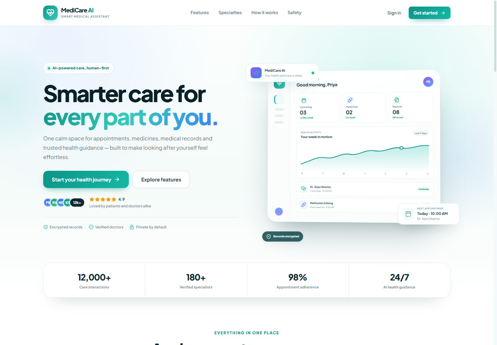 | 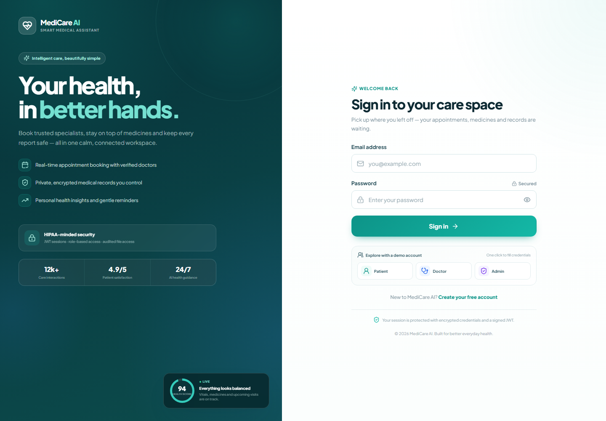 |

### Patient workspace

| Dashboard | Find doctors |
|---|---|
| 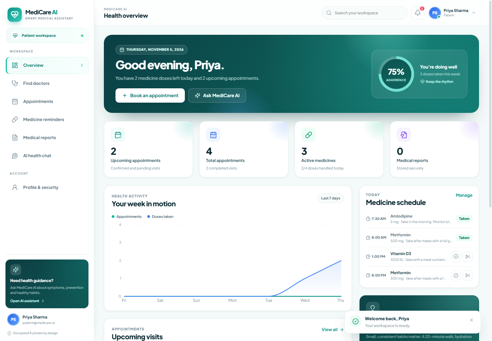 | 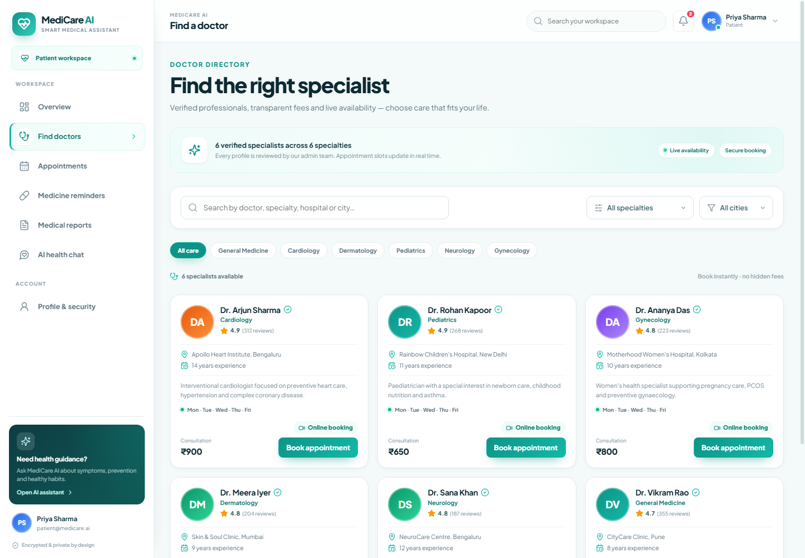 |

| Appointments | Booking modal |
|---|---|
| 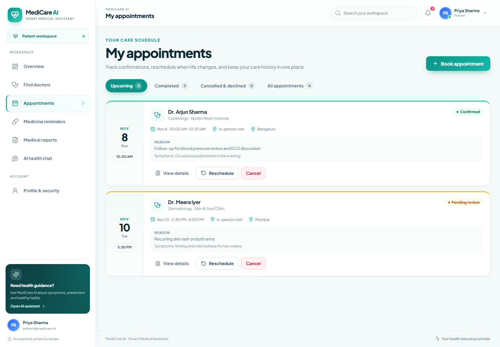 | 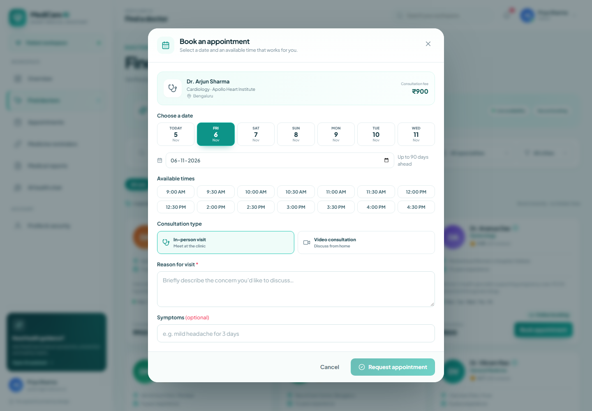 |

| Medicine reminders | Medical reports |
|---|---|
| 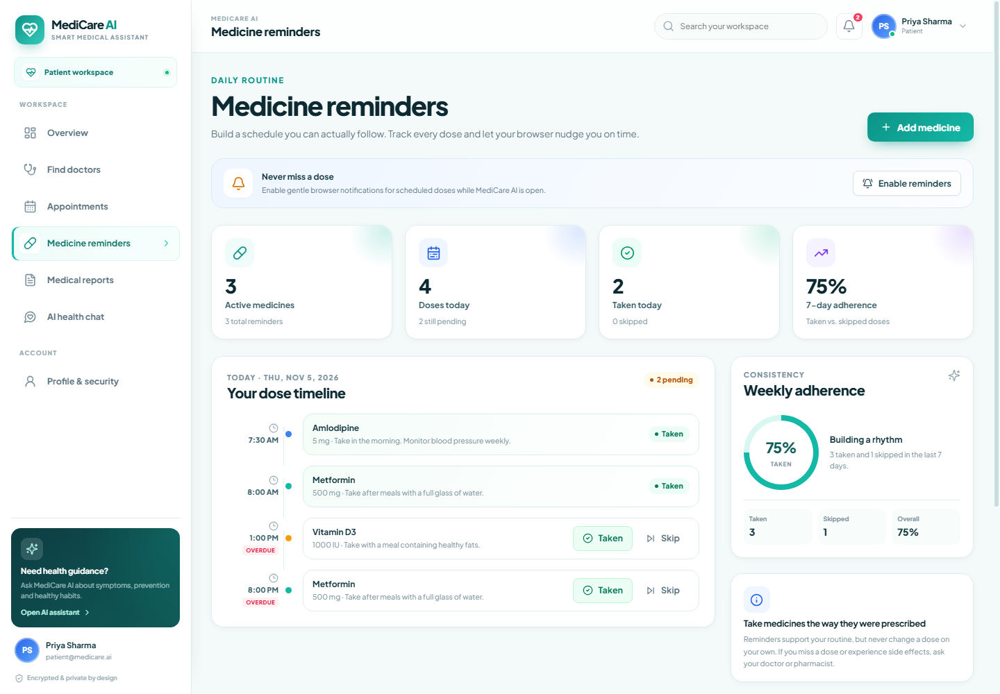 | 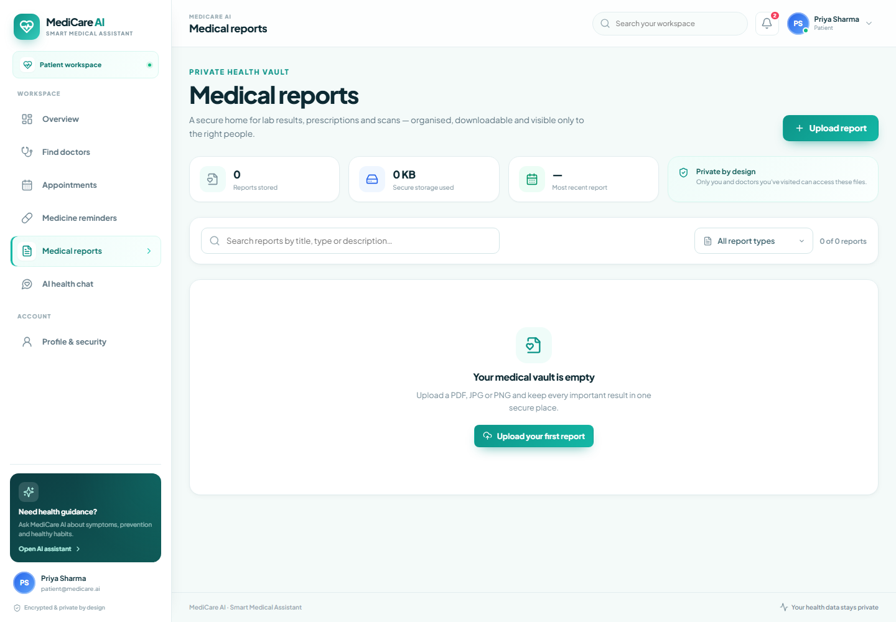 |

| AI health assistant |
|---|
| 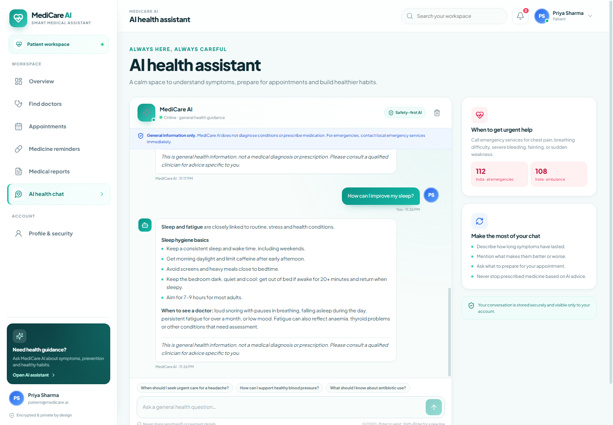 |

### Doctor and admin workspaces

| Doctor dashboard | Admin dashboard |
|---|---|
| 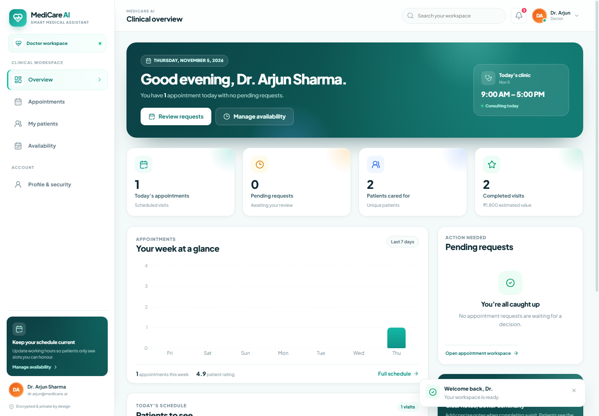 | 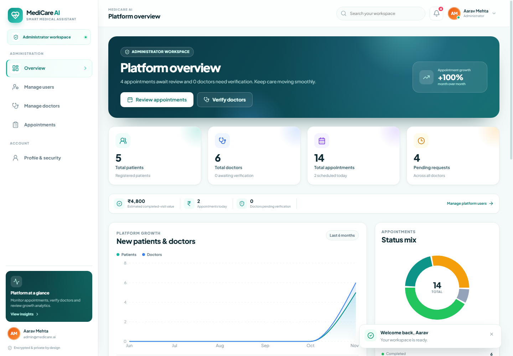 |

### Mobile layout

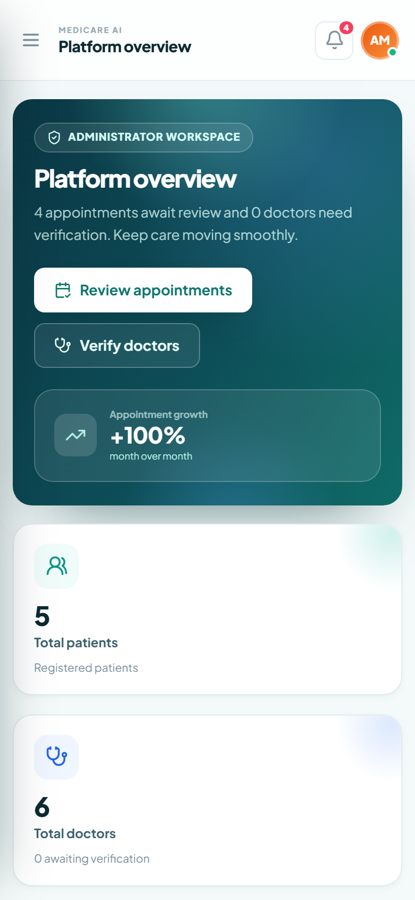

---

## Tech stack

| Layer | Technology |
|---|---|
| Frontend | React 18, Vite 6, React Router DOM 6, Axios, Lucide React, Recharts |
| Backend | Node.js 18+, Express 4, Mongoose 8 |
| Database | MongoDB, MongoDB Atlas, or bundled persistent `mongodb-memory-server` for local development |
| Authentication | JWT (Bearer token), bcryptjs password hashing |
| Validation | express-validator |
| Uploads | Multer (PDF / JPG / PNG, 10 MB default limit) |
| Security | Helmet, CORS allow-list, express-mongo-sanitize, express-rate-limit |
| Styling | Hand-written CSS design system (no UI framework) |

---

## Project structure

```text
D:\priya
├── backend
│   ├── config            # Database connection, constants
│   ├── controllers       # Business logic for each API area
│   ├── middleware        # Auth, validation, uploads, rate limits, errors
│   ├── models            # User, Appointment, Medicine, MedicalRecord, etc.
│   ├── routes            # REST route definitions
│   ├── scripts           # seed.js and smoke-test.js
│   ├── services          # Seeding, notifications, AI, medicine scheduling
│   ├── uploads           # Local report storage (git-ignored)
│   ├── .env.example
│   └── server.js
├── frontend
│   ├── public
│   ├── src
│   │   ├── components    # Sidebar, Topbar, cards, modals, route guards
│   │   ├── context       # Auth, toast and app state
│   │   ├── hooks
│   │   ├── layouts       # Dashboard and auth layouts
│   │   ├── pages         # Landing, auth, patient, doctor, admin, profile
│   │   ├── services      # Axios API clients
│   │   ├── utils
│   │   ├── App.css       # Core design system and responsive shell
│   │   └── pages.css     # Feature-page styles and responsive rules
│   ├── .env.example
│   └── vite.config.js
├── docs
│   └── screenshots         # README screenshots (demo data only)
├── .gitignore
└── README.md
```

---

## Installation

Follow these steps to install dependencies and run the full stack locally.

### Prerequisites
- **Node.js 18 or newer**
- **npm**
- Two terminals (one for backend, one for frontend)

No local MongoDB installation is required for the default setup. The backend can run a persistent local MongoDB instance through `mongodb-memory-server`; data is stored in `backend/.mongo-data` and survives restarts.

### 1. Backend setup

```powershell
cd D:\priya\backend
npm install
Copy-Item .env.example .env
npm run dev
```

The API starts at **http://localhost:5000**. Confirm it is healthy:

```powershell
Invoke-RestMethod http://localhost:5000/api/health
```

Expected response:

```json
{ "success": true, "status": "ok", "service": "MediCare AI API" }
```

### 2. Frontend setup

```powershell
cd D:\priya\frontend
npm install
Copy-Item .env.example .env
npm run dev
```

Open **http://localhost:5173**.

The Vite dev server proxies `/api` to `http://localhost:5000`, and the supplied `frontend/.env` points directly at the API. Either approach works locally.

### 3. Sign in with a demo account

Seeded automatically when the database is empty:

| Role | Email | Password |
|---|---|---|
| Patient | `patient@medicare.ai` | `Patient@123` |
| Doctor | `dr.arjun@medicare.ai` | `Doctor@123` |
| Admin | `admin@medicare.ai` | `Admin@123` |

The login page also has one-click demo buttons for each role.

The seed also creates five patient accounts, six verified doctors across different specialties, availability schedules, appointments, medicine reminders and notifications.

To reset and reseed demo data later:

```powershell
cd D:\priya\backend
npm run seed -- --force
```

Running `npm run seed` without `--force` only seeds when the database is empty.

---

## How to run the project locally

Use two terminals, in this order:

**Terminal 1 — backend**

```powershell
cd D:\priya\backend
npm install
Copy-Item .env.example .env
npm run dev
```

**Terminal 2 — frontend**

```powershell
cd D:\priya\frontend
npm install
Copy-Item .env.example .env
npm run dev
```

Then open **http://localhost:5173** and sign in with a demo account. The API health check is available at **http://localhost:5000/api/health**.

---

## Environment configuration

### Backend: `backend/.env`

Start from `backend/.env.example`.

| Variable | Purpose | Default |
|---|---|---|
| `PORT` | API port | `5000` |
| `NODE_ENV` | Environment mode | `development` |
| `CLIENT_URL` | Allowed frontend origin(s), comma-separated | `http://localhost:5173` |
| `USE_IN_MEMORY_DB` | Use the bundled persistent local database | `true` |
| `MONGO_URI` | Real MongoDB / Atlas connection string | `mongodb://127.0.0.1:27017/medicare_ai` |
| `ALLOW_MEMORY_FALLBACK` | Fall back to local DB if Mongo is unreachable (non-production only) | `true` |
| `JWT_SECRET` | Signing secret for access tokens | generated in development; **required in production** |
| `JWT_EXPIRES_IN` | Token lifetime | `7d` |
| `SEED_ON_START` | Seed demo data when the database is empty | `true` |
| `OPENAI_API_KEY` | Optional server-side AI provider key | empty |
| `OPENAI_MODEL` | Optional OpenAI model | `gpt-4o-mini` |
| `UPLOAD_DIR` | Report storage directory | `uploads` |
| `MAX_FILE_SIZE` | Upload limit in bytes | `10485760` (10 MB) |
| `RATE_LIMIT_MAX` | General API requests per window | `600` |
| `AUTH_RATE_LIMIT_MAX` | Login/registration requests per window | `40` |
| `CHAT_RATE_LIMIT_MAX` | Chat requests per window | `40` |

Generate a strong JWT secret for production:

```powershell
# PowerShell
-join ((48..57) + (65..90) + (97..122) | Get-Random -Count 64 | ForEach-Object { [char]$_ })
```

Or with OpenSSL:

```bash
openssl rand -hex 48
```

Never commit a real `.env` file. The repository `.gitignore` already excludes it.

### MongoDB configuration (Atlas or a local server)

1. Create a cluster/database in MongoDB Atlas, or start a local MongoDB server.
2. Set in `backend/.env`:

```env
USE_IN_MEMORY_DB=false
MONGO_URI=mongodb+srv://<user>:<password>@<cluster>/medicare_ai?retryWrites=true&w=majority
ALLOW_MEMORY_FALLBACK=false
SEED_ON_START=true
```

3. Restart the backend. The API connects to the configured database and seeds demo data only if it contains no users.

Atlas network access must allow your current IP. URL-encode special characters in the database password.

### Optional AI provider

The health assistant works without any external key using the built-in safety-focused health knowledge base. To route general questions through OpenAI instead:

```env
OPENAI_API_KEY=sk-...
OPENAI_MODEL=gpt-4o-mini
```

The key stays server-side and is never exposed to the browser. Emergency detection and medical guardrails remain active regardless of provider.

### Frontend: `frontend/.env`

```env
VITE_API_URL=http://localhost:5000/api
VITE_APP_NAME=MediCare AI
```

For a production deployment where Express serves the built frontend, use:

```env
VITE_API_URL=/api
```

---

## Feature notes

### Appointments
- Slots are generated from each doctor’s weekly schedule, slot duration, breaks, blocked dates, and existing appointments.
- A unique database index on `doctor + date + startTime` prevents double booking even under concurrent requests.
- New bookings start as `pending`; doctors approve, reject, complete or cancel them.
- Rescheduling resets the appointment to `pending` and validates the new slot.
- Patients can cancel with a reason.

### Medicine reminders
- Supports 1–6 daily reminder times, start/end dates, frequency, instructions and colour coding.
- “Taken” and “Skipped” dose logs power today’s schedule and adherence statistics.
- Browser notifications use the Notifications API and require permission. The app explains unsupported or blocked states and provides a test notification.

### Medical reports
- Allowed types: PDF, JPG/JPEG and PNG, up to 10 MB.
- Files are stored with random names; original metadata is never exposed in API responses.
- Downloads require an authenticated request and are streamed through the API, not served as public static files.
- Access is limited to the patient owner, a doctor with a current or prior appointment with that patient, or an admin.
- Reads and downloads are written to the audit log.

### AI health assistant
- Patient-only.
- Provides general education, self-care guidance and signposting.
- Detects emergency phrases and returns urgent guidance to contact local emergency services.
- Does not diagnose conditions or prescribe medicines.
- Stores chat history per patient and supports clearing it.

---

## API overview

Base URL: `http://localhost:5000/api`

Authenticated requests use:

```http
Authorization: Bearer <jwt-token>
```

Responses use a consistent shape:

```json
{ "success": true, "message": "...", "data": { } }
```

Errors:

```json
{ "success": false, "message": "...", "errors": [] }
```

| Area | Main routes |
|---|---|
| Health | `GET /health` |
| Auth | `POST /auth/register`, `POST /auth/login`, `GET /auth/me`, `GET /auth/session`, `POST /auth/logout` |
| Users | `PATCH /users/profile`, `PATCH /users/password` |
| Doctors | `GET /doctors`, `GET /doctors/specializations`, `GET /doctors/:id`, `GET /doctors/:id/slots?date=YYYY-MM-DD` |
| Doctor workspace | `GET/PUT /doctors/me/availability`, `GET /doctors/me/patients`, `GET /doctors/me/patients/:patientId` |
| Appointments | `GET/POST /appointments`, `GET /appointments/upcoming-count`, `GET /appointments/:id`, `PATCH /appointments/:id/status`, `PUT /appointments/:id/reschedule` |
| Medicines | `GET/POST /medicines`, `GET /medicines/today`, `GET /medicines/stats`, `PUT/DELETE /medicines/:id`, `POST /medicines/:id/log` |
| Reports | `GET/POST /records`, `GET /records/:id`, `GET /records/:id/download`, `DELETE /records/:id` |
| Chat | `GET /chat/history`, `GET /chat/suggestions`, `POST /chat/message`, `DELETE /chat/history` |
| Dashboards | `GET /dashboard/patient`, `GET /dashboard/doctor`, `GET /dashboard/admin` |
| Notifications | `GET /notifications`, `PATCH /notifications/:id/read`, `PATCH /notifications/read-all`, `DELETE /notifications/:id` |
| Admin | `GET /admin/users`, `PATCH/DELETE /admin/users/:id`, `GET /admin/doctors`, `GET /admin/appointments`, `PATCH /admin/appointments/:id/status`, `GET /admin/analytics`, `GET /admin/audit-logs` |

Role rules are enforced server-side, not only in the UI. For example, patients cannot access admin routes, doctors cannot create patient appointments, and only patients can use the AI chat or medicine endpoints.

---

## Security and privacy

- Passwords are hashed with **bcrypt (12 rounds)** and never returned by the API.
- JWTs are signed server-side and expire after 7 days by default.
- Protected routes verify the token, load the current user, and reject inactive accounts.
- Role authorization is enforced in middleware for every sensitive route.
- Helmet sets secure HTTP headers; CORS is restricted to configured origins.
- Mongo operator injection is sanitized, and request bodies are validated with express-validator.
- Rate limits apply to the general API, auth endpoints, chat and uploads.
- Report file names are randomised; downloads are authenticated and permission-checked.
- Security-relevant actions are recorded in an audit log with actor, action, entity and IP metadata.
- Uploaded files are excluded from git by default.

> MediCare AI is a demonstration product and is **not** a HIPAA-certified clinical system. For real patient data, add a formal compliance program, encrypted object storage, managed secrets, TLS, backups, monitoring and a reviewed clinical safety policy.

---

## Testing

### Backend API smoke test

With the backend running:

```powershell
cd D:\priya\backend
npm run test:api
```

The suite performs **34 checks** covering:
- Health, auth, registration, duplicate emails and sessions.
- Role-based access control.
- Doctor verification and directory visibility.
- Slot generation, booking, privacy and double-booking protection.
- Rescheduling and doctor approval.
- Medicine creation, dose logging and adherence.
- AI chat safety and emergency escalation.
- Report upload, authenticated download and access control.
- Notifications, profile updates, password changes and dashboards.
- Admin analytics, user management and self-protection rules.

It creates isolated temporary accounts and deletes them afterwards. Seeded demo data is not changed.

### Frontend production build

```powershell
cd D:\priya\frontend
npm run build
```

The build output is written to `frontend/dist`.

### Manual checks
1. Sign in as the patient and book a slot from **Find doctors**.
2. Sign in as the doctor, approve the request and confirm it appears in the patient’s upcoming list.
3. Upload a PDF/JPG/PNG in **Medical reports**, then download it.
4. Ask the AI assistant a general question and an emergency phrase such as “crushing chest pain and cannot breathe”.
5. Sign in as admin, verify a newly registered doctor and review analytics.
6. Resize the browser to a phone width; use the menu button to open the sidebar.

---

## Production build and deployment

1. Build the frontend:

```powershell
cd D:\priya\frontend
npm run build
```

2. Configure `backend/.env` for production:

```env
NODE_ENV=production
PORT=5000
CLIENT_URL=https://your-domain.example
USE_IN_MEMORY_DB=false
MONGO_URI=mongodb+srv://...
JWT_SECRET=<long-random-secret>
SEED_ON_START=false
```

3. Start the backend:

```powershell
cd D:\priya\backend
npm start
```

In production mode, Express serves `frontend/dist` when it exists and keeps `/api` routes separate. If you host the frontend separately, build it with `VITE_API_URL=https://your-api.example/api` and keep `CLIENT_URL` aligned with the frontend origin.

### Production checklist
- Use a managed MongoDB deployment with authentication and backups.
- Store `JWT_SECRET`, `MONGO_URI` and `OPENAI_API_KEY` in a secrets manager.
- Serve everything over HTTPS.
- Move report storage to private object storage (for example S3) and use signed, expiring downloads.
- Add monitoring, error tracking and log retention.
- Review rate limits for your expected traffic.
- Disable `SEED_ON_START` for real deployments.

---

## Troubleshooting

**Backend will not start / port 5000 is in use**

Change `PORT` in `backend/.env`, then update `frontend/.env` and the Vite proxy target if needed.

**Local database fails to reopen**

Stop the backend and remove `backend/.mongo-data` to start a fresh local database. This deletes local demo data.

**Frontend shows “Failed to fetch”**

Confirm the backend is running at `http://localhost:5000/api/health`, and that `VITE_API_URL` points to the correct API URL. Restart Vite after changing `.env`.

**Browser notifications do not appear**

Notifications require permission and a supported browser. They generally require `localhost` or HTTPS. Use **Enable reminders** on the Medicine reminders page and keep the tab open.

**A newly registered doctor does not appear in the directory**

Doctors must be verified by an admin under **Manage doctors** before patients can find them.

**Reports upload but will not open**

Reports are private. Use the in-app download button rather than opening the upload directory directly. Access is checked against your role and care relationship.

---

## Future improvements

- **Payments and billing** — integrate a payment gateway for consultation fees, invoices and refunds.
- **Video consultations** — add WebRTC or a hosted video provider for telemedicine visits inside the appointment flow.
- **Real-time updates** — use WebSockets or server-sent events for live appointment status, notifications and chat.
- **Email/SMS reminders** — send appointment and medicine reminders through a transactional email or SMS provider.
- **Cloud file storage** — move medical reports to private object storage (S3/GCS) with signed, expiring URLs and virus scanning.
- **Multi-factor authentication** — add TOTP or passkeys for patient, doctor and admin accounts.
- **Audit and compliance tooling** — retention policies, exportable audit reports, consent tracking and a formal privacy/compliance program.
- **Analytics** — richer clinical and operational dashboards with date-range filters and CSV export.
- **Internationalisation** — multi-language UI, localised date/time formats and regional emergency numbers.
- **Automated test coverage** — unit tests for controllers and React components, plus end-to-end tests with Playwright.
- **Containerised deployment** — Dockerfiles, Compose setup and CI/CD with automated checks before deploy.
- **Accessibility audit** — full WCAG 2.1 AA review with keyboard and screen-reader testing.
- **AI improvements** — retrieval-augmented answers from vetted medical sources, clearer confidence indicators and clinician-review workflows.

---

## Health disclaimer

MediCare AI provides general health information, not medical advice, diagnosis or treatment. It does not replace a qualified clinician. In an emergency, contact local emergency services immediately.
